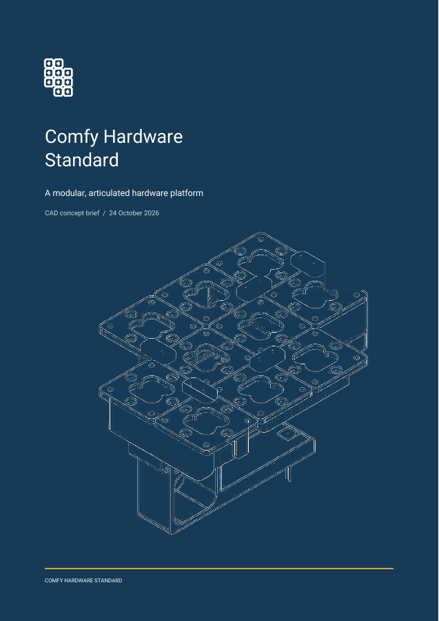

# Onshape Product Brief

A Codex skill for turning an Onshape assembly or part studio into a concise, drawing-led product brief PDF. It pairs CAD inspection and measured geometry with deliberate page design and a rendered-page review.



## Install

```bash
git clone https://github.com/ThomasVuNguyen/onshape-product-brief-skill.git
cp -R onshape-product-brief-skill/onshape-product-brief ~/.codex/skills/
```

Then ask Codex:

> Use `$onshape-product-brief` to make a product brief from this Onshape assembly: [link].

The skill also activates for ordinary requests to create a product brief from Onshape CAD. The agent can use an authenticated Onshape browser session; API credentials are optional.

## What it produces

- A brief with a strong opening and closing page, a concise overview and specification, and CAD-derived illustrations.
- Measurements grounded in exported geometry, marked as reference dimensions until manufacturing information is verified.
- A page-by-page visual check before delivery.

The [Comfy Hardware Standard example](examples/comfy-hardware-standard/comfy-hardware-standard-product-brief.pdf) is a six-page A4 brief created from the user's `Total Assembly`. Its [ReportLab source](examples/comfy-hardware-standard/build_brief.py) and prepared artwork are included for study and reproduction. The design takes pacing cues from the [Raspberry Pi 27W USB-C Power Supply product brief](https://pip-assets.raspberrypi.com/categories/898-raspberry-pi-27w-usb-c-power-supply/documents/RP-008245-DS-1-27w-usb-c-power-supply-product-brief.pdf), which is linked as a reference and is not copied into this repository.

## Helpers

```bash
python3 -m pip install -r requirements.txt
python3 onshape-product-brief/scripts/measure_glb.py assembly.glb
python3 onshape-product-brief/scripts/cad_image.py screenshot.png \
  --crop 200,100,900,800 --color-output hero.png --line-output drawing.png
```

`cad_image.py --help` lists optional crop erasure, line color, and edge settings. The example PDF can be rebuilt with `python3 examples/comfy-hardware-standard/build_brief.py`.

The public example includes prepared artwork and the PDF. Raw CAD exports, full browser screenshots, and the third-party reference PDF are excluded.

## Licensing

The skill, helper scripts, and example build script are MIT licensed. The example's CAD-derived imagery and PDF are presented for demonstration and are not licensed for reuse. Roboto font files are distributed under their [SIL Open Font License](examples/comfy-hardware-standard/fonts/OFL.txt).
